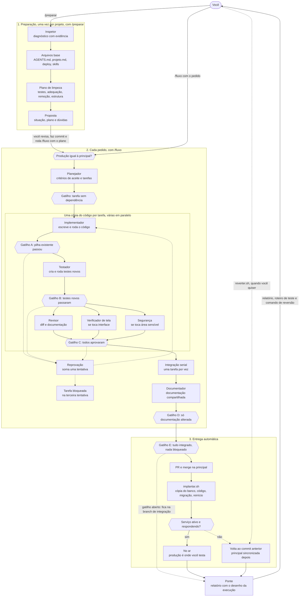
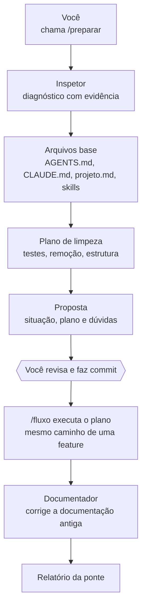
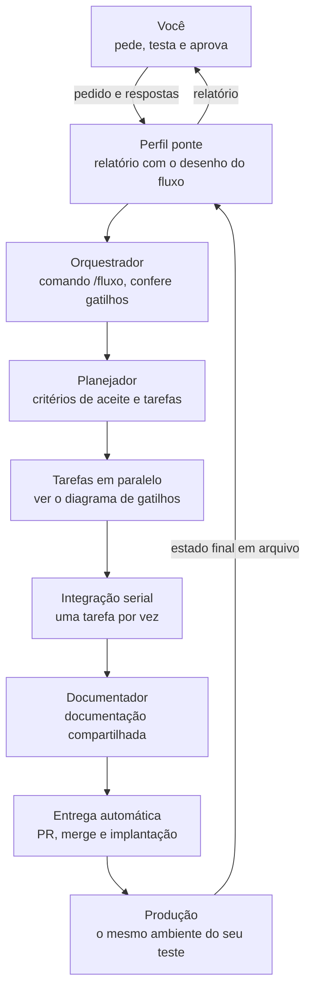
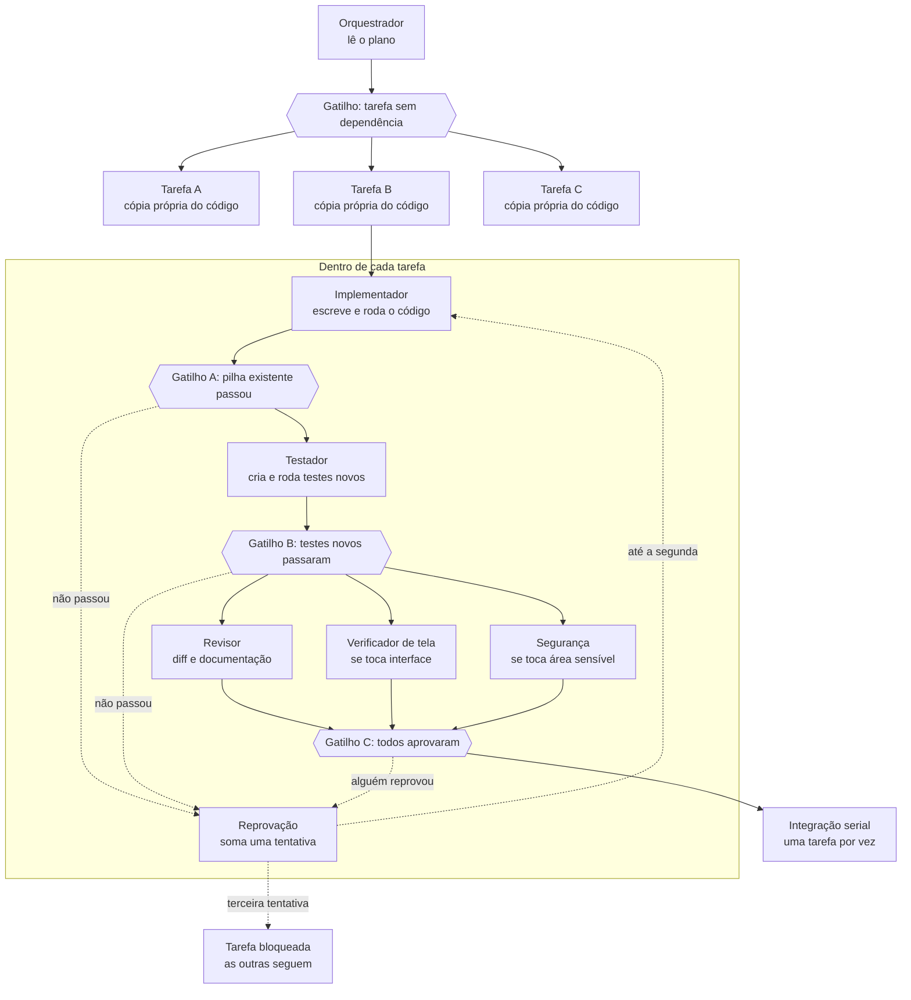
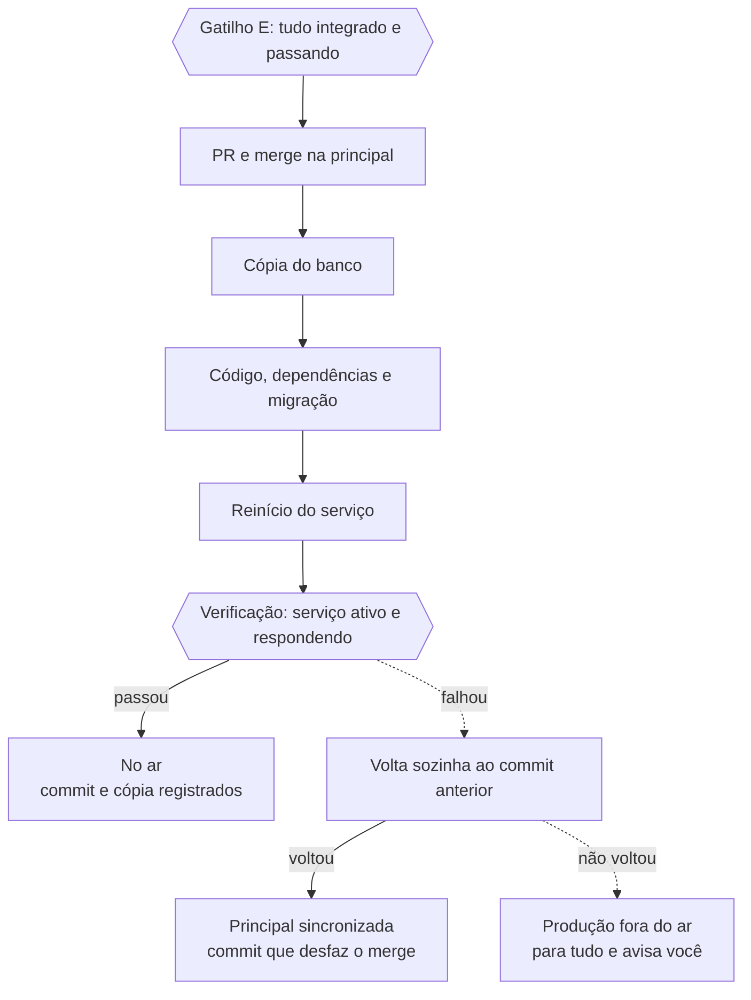
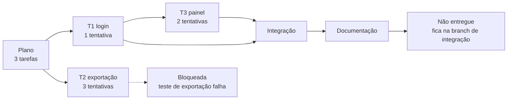

# CyberStack

Stack de agentes de desenvolvimento para o Claude Code, rodando na assinatura Claude. Leva um projeto da preparação inicial até cada feature no ar, com subagentes em paralelo, entrega automática e um relatório único no fim.

Feita para projetos em Python, com banco SQLite3 e front em HTML e JavaScript, rodando como serviço em uma máquina Linux com systemd.

São dois comandos:

| Comando | Quando | O que faz |
|---|---|---|
| `/preparar` | Uma vez por projeto, antes de tudo | Diagnostica o repositório, cria os arquivos base e propõe a limpeza. |
| `/fluxo <pedido>` | A cada feature, e para executar a limpeza aprovada | Planeja, implementa, testa, verifica, integra, documenta, entrega e relata. |

As definições de cada perfil estão em [`.claude/agents/`](../.claude/agents) e os dois comandos em [`.claude/skills/`](../.claude/skills), neste repositório. Como instalar está no [README](../README.md).

Situação: desenho fechado e definições escritas. A stack ainda não rodou em um projeto real.

## Fluxo completo

Do primeiro comando até o sistema no ar, em um desenho só. As seções seguintes detalham cada parte.



Linhas tracejadas são os caminhos de falha, de espera e de reversão.

## Princípios

- **Poucos papéis fixos.** Cada perfil tem uma função, um contexto limpo e permissões próprias.
- **Verificação em vez de instrução.** Teste, lint e conferência de arquivos valem mais do que texto pedindo cuidado.
- **Do mais barato ao mais caro.** Cada etapa só roda se a anterior passou.
- **Testes depois da implementação,** por um agente que parte dos critérios de aceite e não do código.
- **Todos executam, poucos alteram.** Qualquer agente roda a aplicação e os testes na sua cópia do código. A restrição é sobre o que cada um pode modificar.
- **Paralelismo por subagentes.** O orquestrador dispara várias cópias do mesmo perfil, cada uma em sua cópia do código. A integração é serial.
- **Continuidade sem você.** Fim de etapa por condição verificável, limite de tentativas e estado gravado em arquivo.
- **Entrega automática, com volta garantida.** Quando todos os gatilhos passam, o trabalho vai para a principal e para produção sem esperar você. Toda entrega pode ser desfeita com um comando.
- **Um único relatório,** em formato fixo, com o desenho do que aconteceu e as dúvidas numeradas.
- **Orientação em fonte única.** `AGENTS.md` é o arquivo real; `CLAUDE.md` só o importa.
- **Nada se remove sem evidência e sem teste.** Vale para a limpeza inicial e para qualquer feature.

## Preparação do projeto

Antes da primeira feature, o projeto passa por uma etapa própria: entender o que existe, criar os arquivos base e limpar.



O `/preparar` não mexe em código. Ele para na proposta e espera você, porque decidir o que é código morto é o tipo de escolha que pode ir para os dois lados.

**Diagnóstico.** O inspetor roda os comandos do projeto e anota o resultado real, mapeia as pastas, levanta que áreas têm teste, classifica cada documento como correto, desatualizado ou órfão, e procura código morto, problemas de estrutura, o que falta e segredos versionados.

**Código morto exige três verificações.** Nenhuma referência no repositório, não é ponto de entrada e não é carregado de forma dinâmica. Faltou uma, o item é "suspeito": não entra no plano e vira dúvida para você.

**Arquivos base.** `AGENTS.md`, `CLAUDE.md`, `.cyberstack/projeto.md`, as skills locais de teste e de tela, a pasta `deploy/` com os scripts de implantação e a unidade do serviço, e as linhas do `.gitignore`. Só entra o que o diagnóstico confirmou; o resto fica em branco. É o único momento em que um agente escreve os arquivos de orientação, e nada vai para commit sem você.

**Plano de limpeza,** nesta ordem:

1. Rede de segurança: testes que registram o comportamento atual das áreas sem teste que serão tocadas.
2. Adequação à entrega: o que estiver fora do padrão, como caminho do banco fixo no código, banco fora do modo WAL ou falta do endereço de verificação.
3. Remoção de código morto, em grupos coesos, cada tarefa com a lista exata do que sai.
4. Estrutura: movimentos e junções de arquivos.
5. Documentação: corrigida no fim pelo documentador, a partir do diagnóstico.

Toda tarefa de limpeza tem três critérios fixos: a pilha de testes dá o mesmo resultado de antes, nenhum comportamento observável muda e nenhum arquivo fora da lista é alterado. Remoção, adequação e estrutura dependem das tarefas de teste da mesma área, para a rede de segurança existir antes da mudança.

**Execução.** Depois de revisar, fazer commit dos arquivos base, criar a pasta de produção e instalar o serviço, você roda `/fluxo executar o plano em .cyberstack/preparacao/plano.md`. A limpeza percorre o mesmo caminho de uma feature, com os mesmos gatilhos.

## Visão geral de uma feature



No Claude Code, quem conversa com você é sempre a sessão principal, que faz o papel de orquestrador. A ponte é um subagente que escreve o relatório lendo só os artefatos, e o orquestrador repassa o texto sem alterar.

## Gatilhos de disparo



Há dois pontos de disparo em leque: o orquestrador abre um implementador por tarefa independente, e o Gatilho B abre revisor, verificador de tela e segurança ao mesmo tempo sobre o mesmo diff. Entre eles o disparo é em série.

O que o orquestrador confere em cada gatilho:

| Gatilho | Dispara | Condição |
|---|---|---|
| Tarefa liberada | Um implementador por tarefa, em paralelo | A tarefa não depende de outra ainda pendente. |
| A | Testador | O implementador respondeu PRONTO e a pilha existente passa quando o orquestrador roda o comando. |
| B | Revisor, verificador de tela, segurança | O testador aprovou, a pilha completa passa e ele só alterou arquivos nas pastas de teste. |
| C | Integração | Todos os disparados aprovaram e nenhum deles alterou o código. |
| D | Entrega | O documentador só alterou as pastas de documentação compartilhada. |
| E | PR, merge e implantação | Todas as tarefas integradas, nenhuma bloqueada, pilha completa passando na integração e entrega automática ligada. |

O orquestrador não aceita relato: ele mesmo roda o comando de teste e olha a lista de arquivos de cada commit. "A pilha passa" quer dizer que não há falha além das que já existiam antes da execução, medidas por ele na branch de integração. Tela e segurança são disparadas pelo que o diff toca, não só pelo que o plano previu.

Tarefa marcada como `Tipo: testes`, usada na rede de segurança da limpeza, não passa pelo implementador: começa direto no testador.

## Perfis

| Perfil | Modelo | Esforço | Altera | Quando entra |
|---|---|---|---|---|
| Orquestrador (`/fluxo` e `/preparar`) | opus | high | Artefatos; no `/preparar`, os arquivos base | Sempre. É a sessão principal. |
| inspetor | opus | high | Nada | Uma vez por projeto, no `/preparar`. |
| planejador | opus | high | Nada | No início de cada feature. Dispensado em pedido pequeno. |
| implementador | opus | medium | Código e documentação junto do código | Um por tarefa. |
| testador | sonnet | high | Só as pastas de teste | Depois do Gatilho A. |
| revisor | opus | high | Nada | Depois do Gatilho B, sempre. |
| verificador-tela | sonnet | medium | Nada | Depois do Gatilho B, se a tarefa toca interface. |
| seguranca | opus | xhigh | Nada | Depois do Gatilho B, se a tarefa toca área sensível. |
| documentador | sonnet | medium | Só a documentação compartilhada | Uma vez, depois da integração. |
| ponte | sonnet | medium | Nada | Uma vez, no fim. |

Todos podem executar código na sua cópia. Nenhum subagente faz nada com efeito fora dela: banco de produção, envio real de mensagem, cobrança, push ou implantação. Merge e implantação são feitos só pelo orquestrador, na entrega, pelos scripts do projeto.

Se o limite da assinatura apertar, o primeiro ajuste é o implementador para `sonnet` com esforço `high`, e depois o orquestrador para esforço `medium`.

O modelo e o esforço escritos no cabeçalho de `/fluxo` e de `/preparar` valem só no turno em que o comando é digitado. Os subagentes rodam em segundo plano, e cada retorno abre um turno novo, que usa o modelo e o esforço da sessão. Para o orquestrador rodar como na tabela do começo ao fim, abra a sessão já em `opus` com esforço `high`. É também na sessão que se baixa o esforço dele.

### O que cada um faz

- **Inspetor.** Examina o repositório inteiro e entrega o diagnóstico. Comando que ele não rodou não entra como confirmado. Não roda nada que aponte para o banco ou para as integrações de produção.
- **Planejador.** Lê o código, roda o sistema se precisar, escreve os critérios de aceite e divide em tarefas. Duas tarefas só são independentes se não tocam os mesmos arquivos.
- **Implementador.** Roda a pilha antes de começar para ter a linha de base, implementa executando e só entrega com a pilha passando. Não altera teste existente para fazê-lo passar e não escreve os testes da feature.
- **Testador.** Lê os critérios de aceite antes do diff e escreve pelo menos um teste por critério. Se acha defeito, reprova com o teste que falha; não conserta o código.
- **Revisor.** Procura critério não atendido, defeito, teste que só confirma a implementação, código desnecessário, documentação de módulo desatualizada e alteração indevida nos arquivos de orientação. Todo bloqueante tem arquivo, linha e cenário.
- **Verificador de tela.** Sobe a aplicação da tarefa em uma porta temporária e a usa pelo navegador, como uma pessoa, com as contas de teste. Tira uma captura por passo e tenta também os caminhos errados. Não consulta banco, API nem código.
- **Segurança.** Segue o dado da entrada até o uso. Só bloqueia com caminho de exploração.
- **Documentador.** Lê o diff integrado e corrige a documentação compartilhada. Na limpeza, corrige também o que o diagnóstico apontou. Se um arquivo de orientação ficou desatualizado, propõe a mudança em vez de fazer.
- **Ponte.** Relata o que os artefatos dizem, sem interpretar nem suavizar. Falha aparece primeiro.

## Reprovação e bloqueio

1. Qualquer gatilho que falhe soma uma tentativa e é anotado no registro de aprendizado.
2. A tarefa volta ao implementador com o motivo e nada mais.
3. O caminho é refeito desde o Gatilho A.
4. Na terceira tentativa a tarefa é marcada como bloqueada. As outras continuam, menos as que dependem dela, que ficam bloqueadas também.

Se a pilha falhar depois de um merge na integração, o merge é desfeito e a tarefa é tratada como reprovada. O mesmo vale para conflito de merge. Nos dois casos, a tarefa volta ao implementador já com o código das outras tarefas integradas.

## Entrega automática e reversão

O sistema em produção é também o ambiente em que você testa. Por isso, sucesso nos gatilhos significa entrega completa, sem esperar verificação humana, e toda entrega precisa poder ser desfeita.



**Quando entrega.** O Gatilho E fecha quando todas as tarefas foram integradas, nenhuma ficou bloqueada, a pilha completa passa na integração e a entrega automática está ligada em `projeto.md`. Com qualquer tarefa bloqueada, nada é entregue: o trabalho fica na branch de integração e o relatório diz por quê.

**Como entrega.** O orquestrador abre o pull request com o resumo do plano e os vereditos e faz o merge. Em repositório sem pull request, avança a principal direto. Se o merge for recusado por conflito ou por regra do repositório, ele não força. Em seguida roda `deploy/implantar.sh` na pasta de produção, que:

1. copia o banco SQLite, pela API de cópia do próprio SQLite, segura com o sistema no ar;
2. coloca o código do commit e, com a configuração desse commit, instala dependências e roda a migração;
3. reinicia o serviço;
4. verifica, duas vezes seguidas, que o serviço está ativo e que o endereço de verificação responde;
5. registra a implantação: data, commit, cópia do banco e resultado.

Na primeira implantação, o registro ganha também o commit que já estava no ar, para a primeira entrega ter para onde voltar.

**Se a verificação falha,** o script volta sozinho ao commit que estava no ar e reinicia, sem rodar migração de novo. O orquestrador então devolve à principal o conteúdo que está no ar, com um commit novo, para ela não ficar com código que falhou.

**Se o script para antes de trocar o código,** por falha de rede ou da cópia do banco, o orquestrador tenta mais uma vez. Se repetir, relata como não entregue e a principal fica à frente da produção até a próxima entrega.

**Voltar uma versão quando você quiser.** Na pasta de produção:

| Comando | Efeito |
|---|---|
| `deploy/reverter.sh` | Volta para a implantação bem-sucedida anterior. Rodar de novo volta mais uma. |
| `deploy/reverter.sh <commit>` | Volta para um commit específico. |
| `deploy/reverter.sh --listar` | Mostra as implantações registradas. |
| `deploy/reverter.sh --restaurar-banco <cópia>` | Restaura o banco de uma cópia e reinicia. |

A volta funciona mesmo sem acesso ao remoto, porque o commit já está na pasta de produção.

Voltar o código não volta o banco. Restaurar a cópia apagaria tudo o que foi gravado depois dela, então isso só acontece quando você pede. O que torna isso seguro é a regra de migração do `AGENTS.md`: migração só acrescenta, de modo que a versão anterior do código funciona com o banco novo.

**Depois de uma reversão,** a principal ainda contém o código que saiu do ar. No início do próximo `/fluxo`, o orquestrador compara o commit em produção com a ponta da principal e consulta o registro de implantações. Se a ponta da principal já esteve em produção, ele cria um commit que devolve à principal o conteúdo exato do que está no ar e confere que ficou idêntico. Só então começa a feature nova.

**Commit seu direto na principal,** que nunca foi implantado, não é reversão: nada é desfeito, e ele vai ao ar com a próxima entrega.

**Queda de máquina.** O serviço roda como unidade systemd com `Restart=always`, habilitada na inicialização: volta se o processo cair e sobe sozinho quando a máquina liga. O banco em modo WAL resiste a desligamento abrupto. Se o sistema roda em máquina virtual, falta configurar no hospedeiro o início automático da própria máquina virtual.

**O que foi testado.** Os dois scripts rodam em simulação, com um serviço Python e banco SQLite: implantação boa com migração, implantação quebrada com volta automática, reversão manual com o banco preservado, restauração de banco e falha total. A simulação está em `testes/implantacao.sh`. A unidade systemd passa no `systemd-analyze verify`, mas a instalação dela e os comandos com sudo não foram testados em uma máquina real.

**O risco que fica.** Sem ambiente separado, um defeito que passe por todos os gatilhos chega aos usuários antes de você ver. Para sistemas que cobram ou enviam mensagens a clientes, `projeto.md` tem a opção de segurar a entrega quando a execução toca área sensível. Ela vem desligada.

## Estado e artefatos

Tudo o que acontece fica em arquivo, para a execução poder ser retomada e para a ponte ter de onde ler.

```
.cyberstack/
  projeto.md                     configuração do fluxo
  preparacao/
    diagnostico.md               saída do inspetor
    plano.md                     plano de limpeza
  execucoes/<pedido>/
    plano.md                     critérios de aceite e tarefas
    linha-de-base.md             resultado da pilha antes de qualquer tarefa
    decisoes.md                  o que foi decidido sem perguntar
    aprendizado.md               reprovações e propostas de correção
    documentacao.md              saída do documentador
    entrega.md                   resultado da entrega e comando de reversão
    relatorio.md                 relatório da ponte, com o desenho
    <tarefa>/
      estado.json                estado e número de tentativas
      entrega.md                 saída do implementador
      testes.md                  saída do testador
      revisao.md                 saída do revisor
      tela.md                    saída do verificador de tela
      seguranca.md               saída do revisor de segurança
      capturas/                  uma imagem por passo do roteiro
.claude/worktrees/
  <pedido>-integracao/           cópia do código da integração
  <pedido>-<tarefa>/             cópia do código de cada tarefa
```

Estados de uma tarefa: `implementando`, `testando`, `verificando`, `aprovada`, `integrada`, `bloqueada`.

A pasta em que você trabalha não é tocada pelo `/fluxo`. Com o Gatilho E fechado, o resultado vai para a branch principal e para produção; caso contrário, fica na branch `fluxo/<pedido>/integracao`.

## Relatório da ponte

Formato fixo, sempre com as mesmas nove seções:

1. **Situação:** concluído, concluído com ressalvas ou bloqueado, e o estado da entrega: no ar, não entregue, ou voltou sozinha à versão anterior.
2. **O que foi entregue,** em linguagem simples, e o que não foi.
3. **Como foi a execução:** o caminho que as tarefas percorreram.
4. **Evidência:** testes, revisão, tela, segurança e documentação, com os números copiados dos artefatos.
5. **Decisões tomadas por você:** o que os agentes escolheram sozinhos nos pontos ambíguos.
6. **Dúvidas:** numeradas, com opções, a recomendada e o que fica parado. Respondíveis com algo como "1B, 2A".
7. **Próximo passo:** o que acontece se você não fizer nada, e o comando para voltar à versão anterior.
8. **Como testar:** endereço do sistema e roteiro guiado.
9. **Propostas de melhoria permanente:** para aprovar ou recusar.

### O desenho do fluxo no relatório

A seção 3 se ajusta à complexidade do que aconteceu:

- **Sempre:** uma linha por tarefa, legível em qualquer tela, com as etapas percorridas e o número de tentativas.
- **Com duas ou mais tarefas, alguma reprovação ou algum bloqueio:** também um desenho em Mermaid, com um nó por tarefa, quais partiram juntas, quais dependiam de outras, quantas tentativas cada uma levou e o que ficou bloqueado.

O desenho mostra só o que está nos artefatos. Um exemplo com três tarefas, em que a T3 dependia da T1 e a T2 foi bloqueada:



No terminal o Mermaid aparece como texto. O relatório fica salvo em `relatorio.md`, na pasta da execução, para abrir em um visualizador de Markdown e ver o desenho.

Dúvidas comuns chegam juntas no relatório, enquanto os agentes seguem com a melhor suposição. Interrupção no meio só em dois casos: ação irreversível ou todas as tarefas bloqueadas.

## Seu teste

- **Você testa em produção,** depois da entrega, seguindo o roteiro guiado do relatório.
- **Roteiro guiado:** nasce dos critérios de aceite e já foi percorrido pelo verificador de tela antes da entrega.
- **Não gostou do que viu:** o relatório traz o comando de reversão, ou você pede a correção em um novo `/fluxo`.
- **Os agentes nunca tocam o banco de produção.** Cada cópia de trabalho sobe a aplicação em uma porta temporária, com banco próprio criado pelos dados de exemplo e com contas de teste.
- **Integrações externas** ficam em modo de teste nas cópias de trabalho: pagamento e envio de mensagem simulados ou em sandbox.

Cada roteiro percorrido com sucesso pode virar um teste automatizado de navegador, para proteger o fluxo de tela contra regressão sem gastar com agente.

## Orientação dos agentes

| O quê | Onde | Quando entra no contexto |
|---|---|---|
| Comandos, mapa do projeto, regras de "nunca faça" | `AGENTS.md`, abaixo de 200 linhas | Em toda sessão e todo subagente |
| Convenções de uma área do código | `.claude/rules/` | Quando o agente mexe em arquivo daquela área |
| Procedimento passo a passo | Skill em `.claude/skills/` | Quando acionada |
| Explicação do sistema | `docs/`, com ponteiro no `AGENTS.md` | Quando o agente abre |
| Configuração do fluxo e da entrega | `.cyberstack/projeto.md` | Durante o `/fluxo` |

- **Fonte única.** `CLAUDE.md` contém só `@AGENTS.md`. O revisor reprova qualquer conteúdo a mais.
- **Skills locais.** Depois das duas criadas na preparação, uma skill nova só nasce quando um agente errou o mesmo procedimento duas vezes. Se o procedimento cabe em um script, a skill apenas manda rodá-lo.
- **Documentação em dia.** A que fica junto do código é atualizada pelo implementador e cobrada pelo revisor. A compartilhada é atualizada pelo documentador, uma vez, depois da integração, para tarefas paralelas não conflitarem no mesmo arquivo.
- **Aprendizado.** Motivo de reprovação repetido em duas tarefas vira proposta de correção, nesta ordem de preferência: checagem automática, skill, linha no `AGENTS.md`.
- **Ninguém edita a orientação sozinho.** Fora do `/preparar`, `AGENTS.md`, `CLAUDE.md`, regras e skills só mudam com a sua aprovação, pela seção de propostas do relatório.

## O que continua com você

- Aprovar a proposta de preparação e fazer commit dos arquivos base.
- Instalar o serviço na máquina, uma vez, com sudo.
- Decidir voltar uma versão. O relatório traz o comando.
- Restaurar o banco de uma cópia, que apaga o que foi gravado depois dela.
- Qualquer ação irreversível fora da entrega: exclusão de dados, envio a cliente.
- Segredos versionados que o diagnóstico encontrar. Trocar credencial é com você.
- Tarefas bloqueadas e suspeitos de código morto.
- O teste de uso. O agente julga bem "funciona" e "está quebrado", e pior "está agradável".
- Aprovar ou recusar as propostas de melhoria.

## Primeiro uso em um projeto

- [ ] Stack instalada: `.claude/agents/` e `.claude/skills/` no projeto ou em `~/.claude/`.
- [ ] Permissões do Claude Code liberando os comandos de teste, lint e execução.
- [ ] Sessão aberta em `opus` com esforço `high`, o modelo e o esforço do orquestrador.
- [ ] Ferramenta de navegador configurada, se for usar o verificador de tela.
- [ ] `/preparar`, depois revisar os arquivos base e fazer commit.
- [ ] Pasta de produção clonada do repositório, com `.venv` e o banco no caminho de `deploy/config.env`.
- [ ] Serviço instalado e habilitado com os comandos do topo de `deploy/<serviço>.service`.
- [ ] `/fluxo executar o plano em .cyberstack/preparacao/plano.md`, para a limpeza.
- [ ] Primeira feature pequena, de uma tarefa só, para calibrar os tetos de turnos.
